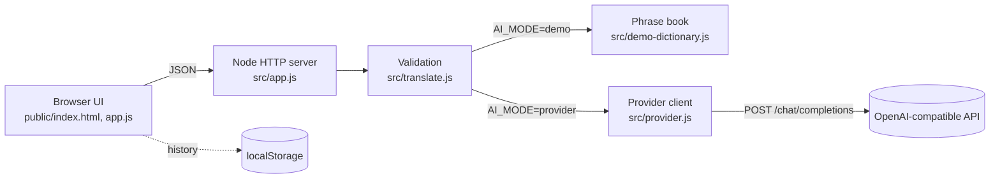

# Translation Desk

A small, self-hosted translation workspace. A dependency-free Node.js HTTP service serves a polished browser UI and proxies translation requests to any **OpenAI-compatible chat completions API** (OpenAI, Azure OpenAI-compatible gateways, OpenRouter, Ollama, LM Studio, vLLM, …).

Without a provider it runs in an explicit **demo mode** that translates only phrases from a built-in phrase book and **rejects everything else** instead of producing fake output.

## Features

- Text input with character counter, source language (or auto-detect) and target language selectors, swap, copy, `Ctrl+Enter` shortcut.
- Real server-side translation through `POST {OPENAI_BASE_URL}/chat/completions`; the API key never reaches the browser.
- Strict provider response validation: the model must return a JSON object with a non-empty `translation`; implausibly long output, empty output, non-JSON output or missing choices are rejected.
- Normalized provider error handling: unreachable, timeout, auth failure, rate limiting, HTTP errors and invalid responses map to stable error codes. Provider response bodies are never forwarded.
- Honest demo mode: 11 curated phrases in English, Spanish, French, German and Hindi. Matching ignores case, whitespace and punctuation. Unknown phrases return `422 demo_phrase_unsupported`; languages outside the phrase book return `422 demo_language_unsupported`.
- Optional translation history kept only in the browser's `localStorage` (toggle + clear button).
- Input validation (types, required fields, supported languages, max length, unknown fields, JSON content type, 64 KB body limit).
- Security headers on every response (strict CSP with no inline script, `nosniff`, `frame-ancestors 'none'`, no referrer). All UI rendering uses `textContent`; no untrusted HTML is ever injected.
- Binds to `127.0.0.1:3003` by default.

## Requirements

- **Node.js 18.18 or newer.** Developed and fully tested on Node 18.18.0 (Windows); newer LTS releases are expected to work but were not part of local verification. It relies only on built-ins (`fetch`, `AbortController`, `node:test`, `node:http`). There are **no npm dependencies**, so `npm install` is not needed.
- `npm run dev` uses `node --watch`, which is experimental on Node 18 (a warning is printed) and stable on Node 20+.
- Docker is optional. The image is based on `node:20-alpine`.

## Quick start

```powershell
git clone https://github.com/Sailesh4cs/translation-desk.git
cd translation-desk
npm start            # demo mode on http://127.0.0.1:3003 (no API key needed)
```

Open <http://127.0.0.1:3003> and click one of the sample phrases.

### Using a real provider

```powershell
Copy-Item .env.example .env
# edit .env: set AI_MODE=provider and OPENAI_API_KEY=...
npm start
```

`server.js` loads `.env` with a tiny built-in parser; variables already set in the environment take precedence. Example for a local Ollama server:

```env
AI_MODE=provider
OPENAI_API_KEY=ollama            # any non-empty value; Ollama ignores it
OPENAI_BASE_URL=http://127.0.0.1:11434/v1
OPENAI_MODEL=llama3.1
```

## Configuration

| Variable | Default | Description |
| --- | --- | --- |
| `HOST` | `127.0.0.1` | Interface to bind. Use `0.0.0.0` only behind a trusted network/proxy (the Docker image does this inside the container). |
| `PORT` | `3003` | HTTP port (`0` = random free port). |
| `AI_MODE` | `provider` if a key is set, else `demo` | `demo` or `provider`. `provider` without a key fails at startup. |
| `OPENAI_API_KEY` | – | Bearer token for the provider. Server-side only. |
| `OPENAI_BASE_URL` | `https://api.openai.com/v1` | Base URL of an OpenAI-compatible API (must be http/https). |
| `OPENAI_MODEL` | `gpt-4o-mini` | Model name sent to the provider. |
| `PROVIDER_TIMEOUT_MS` | `20000` | Abort provider calls after this many ms (500–120000). |
| `MAX_TEXT_LENGTH` | `5000` | Maximum characters per request (1–20000). |

Invalid configuration aborts startup with a clear message.

## Architecture



```
translation-desk/
├── server.js               # entrypoint: .env loading, listen, graceful shutdown
├── src/
│   ├── app.js              # routing, static files, error handling
│   ├── config.js           # env parsing/validation, public (non-secret) config
│   ├── http.js             # JSON helpers, body limits, security headers, static serving
│   ├── provider.js         # OpenAI-compatible client with timeout + error mapping
│   ├── translate.js        # request validation, demo + provider translation, output validation
│   ├── demo-dictionary.js  # curated phrase book used by demo mode
│   └── languages.js        # supported language list
├── public/                 # UI (HTML/CSS/JS, no build step)
├── test/                   # node:test suites
└── scripts/smoke.js        # end-to-end smoke check
```

The provider prompt instructs the model to treat user text as content (not instructions) and to reply with `{"translation": "...", "detectedSourceLanguage": "xx"}`. Responses wrapped in a Markdown code fence are tolerated; anything else is rejected with `502`.

## API

All responses are JSON. Errors use a common envelope:

```json
{ "error": { "code": "validation_error", "message": "…", "details": { "fields": { "text": "Text is required." } } } }
```

### `GET /api/health`

`200 {"status":"ok","mode":"demo"}`

### `GET /api/config`

Public configuration for the UI (never contains secrets):

```json
{
  "mode": "demo",
  "model": null,
  "providerHost": null,
  "maxTextLength": 5000,
  "languages": [{ "code": "en", "name": "English" }],
  "demo": { "languages": ["en","es","fr","de","hi"], "phrases": ["Hello", "…"] }
}
```

### `POST /api/translate`

Request (`Content-Type: application/json`, max 64 KB):

| Field | Type | Required | Notes |
| --- | --- | --- | --- |
| `text` | string | yes | Non-blank, ≤ `MAX_TEXT_LENGTH` characters. |
| `sourceLanguage` | string | no | Language code or `"auto"` (default). |
| `targetLanguage` | string | yes | Supported language code, different from `sourceLanguage`. |

Supported codes: `ar zh nl en fr de hi it ja ko pt es`.

Success `200`:

```json
{
  "translation": "Où est la gare ?",
  "sourceLanguage": "en",
  "targetLanguage": "fr",
  "detectedSourceLanguage": "en",
  "mode": "demo",
  "model": null,
  "notice": "Demo mode: translations come only from a small built-in phrase book. No AI provider was called.",
  "durationMs": 1
}
```

Errors:

| Status | Code | When |
| --- | --- | --- |
| 400 | `invalid_json`, `validation_error` | Malformed body, invalid/unknown fields |
| 404 | `not_found` | Unknown route |
| 405 | `method_not_allowed` | Wrong HTTP method (`Allow` header set) |
| 413 | `payload_too_large` | Body > 64 KB |
| 415 | `unsupported_media_type` | Not `application/json` |
| 422 | `demo_phrase_unsupported`, `demo_language_unsupported` | Demo mode cannot translate this honestly |
| 502 | `ai_provider_unavailable`, `ai_provider_error`, `ai_provider_auth_failed`, `ai_provider_invalid_response` | Provider failures |
| 503 | `ai_provider_rate_limited` | Provider returned 429 |
| 504 | `ai_provider_timeout` | Provider exceeded `PROVIDER_TIMEOUT_MS` |

Example:

```powershell
curl.exe -s -X POST http://127.0.0.1:3003/api/translate -H "Content-Type: application/json" -d '{\"text\":\"Thank you\",\"sourceLanguage\":\"en\",\"targetLanguage\":\"de\"}'
```

## Testing

```powershell
npm test         # node --test: config, demo, validation, static/security, provider (mocked fetch + local mock HTTP provider)
npm run smoke    # starts a demo server on a free port and exercises the API + UI
$env:SMOKE_BASE_URL="http://127.0.0.1:3003"; npm run smoke   # check an already running instance (demo or provider)
```

The provider tests cover the success path, request shape (URL, bearer token, model, prompt), Markdown-fenced JSON, malformed output, HTTP 401/429/500 mapping, network failure, timeout, non-leakage of keys/provider bodies, and a full round trip against a local mock OpenAI-compatible server.

## Docker

```powershell
docker build -t translation-desk .
docker run --rm -p 127.0.0.1:3003:3003 translation-desk                     # demo mode
docker run --rm -p 127.0.0.1:3003:3003 --env-file .env -e HOST=0.0.0.0 translation-desk   # provider mode
```

The image runs as the unprivileged `node` user, binds `0.0.0.0` inside the container, and publishes only to the host's loopback in the commands above. A `HEALTHCHECK` polls `/api/health`.

## Local deployment notes

- Run behind a reverse proxy (Caddy, nginx, IIS) for TLS if exposed beyond localhost; the service itself has no authentication or rate limiting.
- Use a process manager (systemd, pm2, NSSM on Windows) and set environment variables there rather than in `.env` for production.
- Logs go to stdout/stderr; provider errors are logged without request text or credentials.

## Limitations

- Demo mode is intentionally tiny (11 phrases × 5 languages) and exists to show the UI flow honestly; it is not a translator.
- Provider quality, cost and data handling depend on the configured provider. Text is sent to that provider.
- No streaming, document upload, glossary, or authentication. No server-side persistence; history lives only in the browser.
- Language auto-detection relies on the provider's reported `detectedSourceLanguage`, which is validated for format but not verified.
- Length plausibility check (≤ 6× input or 500 chars) is a heuristic guard against runaway output.

## License

No license file is included yet. All rights reserved until the owner adds one.
